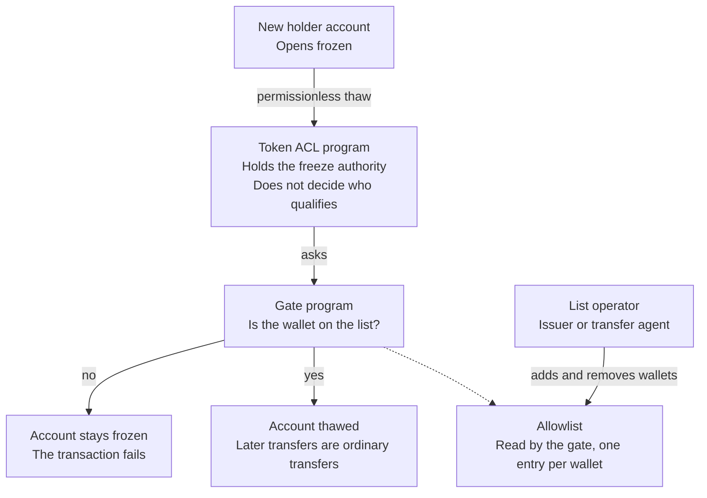

import AllowlistAdd from "/snippets/examples/paths/assets/gated-token/allowlist-add.mdx";
import FetchList from "/snippets/examples/paths/assets/gated-token/fetch-list.mdx";
import Mint from "/snippets/examples/paths/assets/gated-token/mint.mdx";
import TransferBlocked from "/snippets/examples/paths/assets/gated-token/transfer-blocked.mdx";

Your mint creates every token account frozen. This step uses the gate: an
address you approve can have its account thawed against an onchain list, and an
address you have not approved cannot.

## How the pieces fit

Three programs cooperate:

1. **Token-2022** holds the mint and creates every new account frozen.
2. **The Token ACL program** holds the delegated freeze authority, through a
   config account for each mint, and exposes a permissionless thaw. It does not
   decide who qualifies.
3. **A gate program** makes that decision. With an address-based list as the
   gate, qualifying means being on the list.

Three overrides remain with the issuer: freeze or thaw an account directly,
swap the gate program, or reclaim the freeze authority from Token ACL.



<div className="sol-mermaid" data-fallback="mermaid" data-mermaid="026c5fd42f1b">
  

  
</div>

<Steps titleSize="h3">

<Step title="Confirm the gate is in place">

The create transaction in the previous step already handed the freeze
authority to the Token ACL mint config, created the allowlist, pointed the gate
at it, and turned on permissionless thaw. The
[inspect-mint output](/developers/docs/tokenization/tutorials/issuing/create-the-mint#confirm-what-you-built)
confirms it: the freeze authority is `$MINT_CONFIG`, a program-derived address
of the Token ACL program (`TACLkU6CiCdkQN2MjoyDkVg2yAH9zkxiHDsiztQ52TP`), not
the program ID itself.

If the freeze authority is your own key, the mint was created without Token
ACL; Token ACL's create config instruction, signed by that key, can still take
it over. If it is none, a freeze authority cannot be restored once it is unset,
nothing can thaw an account, and the mint cannot be gated. Create a new one.

</Step>

<Step title="Create a holder to approve">

Generate a key for an onboarded client, and fund it so it can pay its own
transaction fees.

```bash Terminal
solana-keygen new --no-bip39-passphrase --silent \
  --outfile ~/.config/solana/demo-holder.json
export HOLDER=$(solana-keygen pubkey ~/.config/solana/demo-holder.json)
solana airdrop 1 $HOLDER --url ${RPC_URL:-devnet}
```

</Step>

<Step title="Add the holder to the allowlist">

This records the onboarding decision. Save this as `allowlist-add.ts` (in
Rust, `src/bin/allowlist-add.rs`) and run it with `$HOLDER`.

<AllowlistAdd />

Read the list back to confirm. The script takes the list from `$LIST`, the
allowlist address `create-the-mint` printed.

<FetchList />

</Step>

<Step title="Mint to the holder">

Minting creates the holder's token account and thaws it in the same
transaction: the script inserts Token ACL's permissionless thaw between the
account creation and the mint, and the gate program approves it because the
holder is on the list. If the holder is not on the list, the whole transaction
fails, so there is no partly minted state. Save this as `mint.ts` (in Rust,
`src/bin/mint.rs`) and run it with `$HOLDER 1000`.

<Mint />

The fee payer signs, because it holds the mint authority on this mint. Where
the mint authority sits on its own key, this is the script that uses it, and no
other key can create supply.

The Mosaic SDK output starts with a decoded Token ACL mint config and an
address. `@solana/token-acl-sdk` 0.4.0 prints them while it builds the
permissionless thaw; they are not part of the transaction.

</Step>

<Step title="Show that the gate rejects a non-holder">

Generate a third key, leave it off the list, and have the holder send tokens to
it. Save this as `transfer.ts` (in Rust, `src/bin/transfer.rs`) and run it with
`$OUTSIDER 1`.

```bash Terminal
solana-keygen new --no-bip39-passphrase --silent \
  --outfile ~/.config/solana/demo-outsider.json
export OUTSIDER=$(solana-keygen pubkey ~/.config/solana/demo-outsider.json)
```

<TransferBlocked />

It fails. The transfer creates the outsider's token account and inserts a
permissionless thaw for it; Token ACL hands the decision to the gate program,
and the gate rejects a wallet that is not on the list with custom program error
`0x1002` (4098). The transfer instruction never runs, and because the RPC node
rejects the transaction in simulation, it never lands and no fee is charged.

Now add the outsider to the list with `allowlist-add` and run the same transfer
again:

```bash Terminal
npx tsx allowlist-add.ts $OUTSIDER
npx tsx transfer.ts $OUTSIDER 1
```

In Rust, run `cargo run --release --bin allowlist-add -- $OUTSIDER` and then
`cargo run --release --bin transfer -- $OUTSIDER 1`. The transfer succeeds and
prints its signature. The only change was the onboarding decision recorded on
the list.

Leave the outsider on the list. Removing a wallet is the
[offboarding step](/developers/docs/tokenization/tutorials/issuing/operate-the-token#offboard-a-holder)
at the end of the next page, and it does more than reverse the add: it also
freezes the wallet's existing token account.

</Step>

</Steps>

## Blocklists

The same gate program supports a blocklist instead of an allowlist, where every
address qualifies except the ones you name. An allowlist fails closed: an
address holds the token only after it has been added. A blocklist fails open:
an address holds the token unless it has been named. A blocklist suits cases
where open holding is the intended design and the list acts as a sanctions
overlay. [Token ACL](/developers/docs/tokenization/token-acl) shows how to
create one.

## Next steps

- [Operate the token](/developers/docs/tokenization/tutorials/issuing/operate-the-token):
  freeze, pause, force a transfer, burn, and offboard a holder
