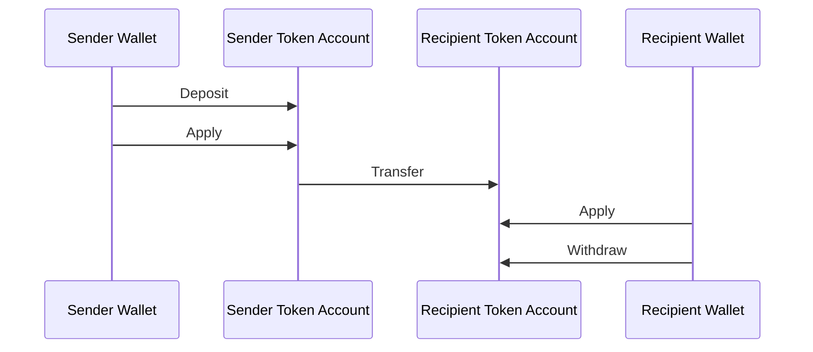
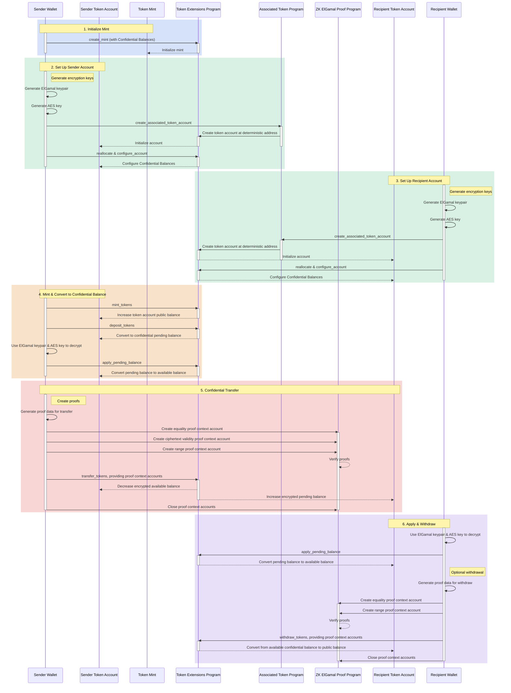

## ¿Qué son los Saldos Confidenciales?

<Frame>
  <iframe src="https://www.youtube-nocookie.com/embed/Bqs95tFcRIU" title="YouTube video player" allow="accelerometer; autoplay; clipboard-write; encrypted-media; gyroscope; picture-in-picture; web-share" referrerPolicy="strict-origin-when-cross-origin" allowFullScreen className="w-full aspect-video" />
</Frame>

  [https://www.youtube.com/watch?v=Bqs95tFcRIU](https://www.youtube.com/watch?v=Bqs95tFcRIU)

Saldos Confidenciales es una extensión de Token-2022 que te permite transferir tokens
entre token accounts sin revelar el monto de la transferencia. Esto es útil para
transacciones que preservan la privacidad. Solo los montos de transferencia y los saldos de tokens son
privados. Las direcciones de las token accounts siguen siendo públicas.

- [Descripción general del protocolo](https://www.solana-program.com/docs/confidential-balances/overview) -
  Detalles sobre el protocolo criptográfico subyacente
- [Guía de inicio rápido](https://www.solana-program.com/docs/confidential-balances#setup) -
  Configuración y comandos básicos de CLI
- [Confidential Balances Cookbook](https://github.com/solana-developers/Confidential-Balances-Sample) -
  Fragmentos de código que muestran cómo usar Saldos Confidenciales

### ¿Cómo funciona?

La extensión de Saldos Confidenciales agrega
[instrucciones](https://github.com/solana-program/token-2022/blob/efd0c957fefbd79882d77df5fb2dac88c001249c/program/src/extension/confidential_transfer/instruction.rs#L29)
al Token Extension program que te permite transferir tokens entre
cuentas sin revelar el monto de la transferencia.

  

  

Confidential Balances Basic Overview

El flujo básico de las transferencias confidenciales de tokens es el siguiente:

1. Crea una mint account con Saldos Confidenciales habilitados.
2. Crea token accounts con Saldos Confidenciales habilitados para el emisor y
   el destinatario.
3. Acuña tokens en la cuenta del emisor.
4. **Deposita** el saldo público del emisor en el **saldo pendiente
   confidencial**.
5. **Aplica** el saldo pendiente del emisor al **saldo disponible
   confidencial**.
6. **Transfiere** de forma confidencial los tokens desde la token account del
   emisor a la token account del destinatario.
7. **Aplica** el saldo pendiente del destinatario al **saldo disponible
   confidencial**.
8. **Retira** el saldo disponible confidencial del destinatario al **saldo
   público**.

### Claves de auditor

Una mint account de Saldos Confidenciales puede almacenar una clave pública ElGamal global opcional para el auditor. Cuando se configura una, cada transferencia confidencial incluye el monto
cifrado para el emisor, el destinatario y el auditor. La prueba de transferencia verifica
que los tres textos cifrados contienen el mismo monto. El público sigue sin poder leer
el monto, pero el titular de la clave secreta del auditor puede descifrar los montos de transferencia
para esa mint account.

La autoridad de Saldos Confidenciales establece la clave del auditor al inicializar la
extensión o la modifica posteriormente con `UpdateMint`. La autoridad puede rotar o
eliminar la clave. Una rotación se aplica solo a las transferencias futuras, por lo que se deben conservar las claves
secretas anteriores cuando se requiere acceso a auditorías históricas. Las claves de auditor proporcionan acceso de lectura; no autorizan transferencias de tokens ni revelan el saldo confidencial completo de una cuenta.

Para ejemplos de configuración y rotación, consulta
[Configurar un auditor](/developers/docs/tokens/extensions/confidential-transfer/issuer-guide#configure-an-auditor).
Las billeteras, exploradores, exchanges y proveedores de cumplimiento normativo también deben revisar la
[guía de integración del auditor](/developers/docs/tokens/extensions/confidential-transfer/integration-guide#auditors-and-compliance).

Para más detalles sobre los pasos del flujo de transferencia confidencial,
consulta las páginas correspondientes:

<Columns cols={2}>
  <Card
    title="Crear Mint Account"
    href="/developers/docs/tokens/extensions/confidential-transfer/create-mint"
  >
    Cómo crear una mint account con Saldos Confidenciales habilitados
  </Card>
  <Card
    title="Crear Token Account"
    href="/developers/docs/tokens/extensions/confidential-transfer/create-token-account"
  >
    Cómo configurar una token account con Saldos Confidenciales habilitados
  </Card>
  <Card
    title="Depositar Tokens"
    href="/developers/docs/tokens/extensions/confidential-transfer/deposit-tokens"
  >
    Cómo depositar tokens en el saldo pendiente confidencial
  </Card>
  <Card
    title="Aplicar Saldo Pendiente"
    href="/developers/docs/tokens/extensions/confidential-transfer/apply-pending-balance"
  >
    Cómo aplicar el saldo pendiente al saldo confidencial disponible
  </Card>
  <Card
    title="Retirar Tokens"
    href="/developers/docs/tokens/extensions/confidential-transfer/withdraw-tokens"
  >
    Cómo retirar tokens del saldo confidencial disponible
  </Card>
  <Card
    title="Transferir Tokens"
    href="/developers/docs/tokens/extensions/confidential-transfer/transfer-tokens"
  >
    Cómo transferir tokens de forma confidencial entre token accounts
  </Card>
  <Card
    title="Guía de Integración"
    href="/developers/docs/tokens/extensions/confidential-transfer/integration-guide"
  >
    Cómo las billeteras, exploradores y exchanges pueden dar soporte a tokens de Saldos Confidenciales
  </Card>
  <Card
    title="Guía para Emisores"
    href="/developers/docs/tokens/extensions/confidential-transfer/issuer-guide"
  >
    Cómo emitir y operar un token de Saldos Confidenciales (política de aprobación,
    auditores, comisiones, emisión y quema)
  </Card>
</Columns>

El diagrama a continuación muestra una secuencia detallada del flujo básico para
transferencias de tokens confidenciales:

  

  

Confidential Balances Detailed Overview

## Instrucciones de Saldos Confidenciales

La lista completa de
[instrucciones](https://github.com/solana-program/token-2022/blob/efd0c957fefbd79882d77df5fb2dac88c001249c/program/src/extension/confidential_transfer/instruction.rs#L29)
de la extensión de Saldos Confidenciales es la siguiente:

| Instrucción                     | Descripción                                                                                                                                                            |
| ------------------------------- | ---------------------------------------------------------------------------------------------------------------------------------------------------------------------- |
| `InitializeMint`                | Habilita los Saldos Confidenciales en una mint account. Esta instrucción debe incluirse en la misma transacción que la instrucción `TokenInstruction::InitializeMint`. |
| `UpdateMint`                    | Actualiza la política de aprobación de cuentas de la mint account y la clave pública ElGamal global opcional del auditor.                                              |
| `ConfigureAccount`              | Habilita los Saldos Confidenciales en una token account.                                                                                                               |
| `ApproveAccount`                | Aprueba una token account para Saldos Confidenciales si la mint account requiere aprobación para nuevas token accounts.                                                |
| `EmptyAccount`                  | Vacía los saldos confidenciales pendientes y disponibles para permitir el cierre de un token account.                                                                  |
| `Deposit`                       | Convierte el saldo público de tokens en saldo confidencial pendiente.                                                                                                  |
| `Withdraw`                      | Convierte el saldo confidencial disponible de vuelta a saldo público.                                                                                                  |
| `Transfer`                      | Transfiere tokens entre token accounts de forma confidencial.                                                                                                          |
| `ApplyPendingBalance`           | Convierte el saldo pendiente en saldo disponible tras depósitos o transferencias.                                                                                      |
| `EnableConfidentialCredits`     | Permite que un token account reciba transferencias de tokens confidenciales.                                                                                           |
| `DisableConfidentialCredits`    | Bloquea las transferencias confidenciales entrantes mientras permite las transferencias públicas.                                                                      |
| `EnableNonConfidentialCredits`  | Permite que un token account reciba transferencias de tokens públicas.                                                                                                 |
| `DisableNonConfidentialCredits` | Bloquea las transferencias regulares para que la cuenta solo reciba transferencias confidenciales.                                                                     |
| `TransferWithFee`               | Transfiere tokens entre token accounts de forma confidencial con una comisión.                                                                                         |
| `ConfigureAccountWithRegistry`  | Forma alternativa de configurar token accounts para Saldos Confidenciales usando una cuenta `ElGamalRegistry` en lugar de la prueba `VerifyPubkeyValidity`.            |
