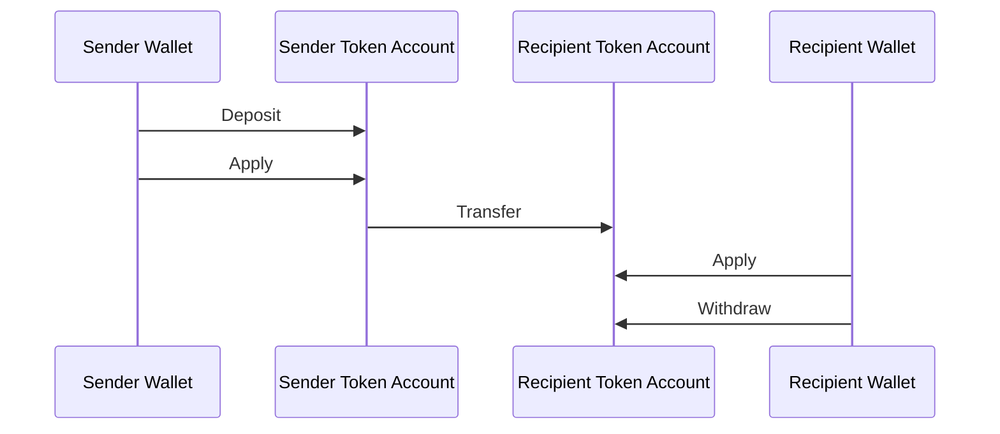
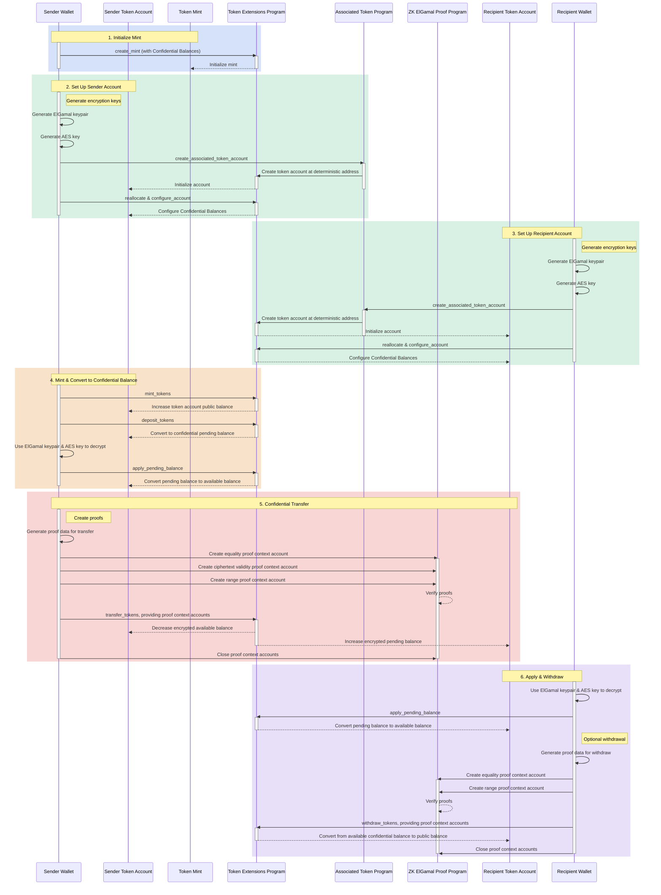

## Apa itu Confidential Balances?

<Frame>
  <iframe src="https://www.youtube-nocookie.com/embed/Bqs95tFcRIU" title="YouTube video player" allow="accelerometer; autoplay; clipboard-write; encrypted-media; gyroscope; picture-in-picture; web-share" referrerPolicy="strict-origin-when-cross-origin" allowFullScreen className="w-full aspect-video" />
</Frame>

  [https://www.youtube.com/watch?v=Bqs95tFcRIU](https://www.youtube.com/watch?v=Bqs95tFcRIU)

Confidential Balances adalah ekstensi Token-2022 yang memungkinkan Anda mentransfer token
antara token account tanpa mengungkapkan jumlah transfer. Ini berguna untuk
transaksi yang menjaga privasi. Hanya jumlah transfer dan saldo token yang
bersifat privat. Alamat token account tetap bersifat publik.

- [Ikhtisar Protokol](https://www.solana-program.com/docs/confidential-balances/overview) -
  Detail tentang protokol kriptografi yang mendasarinya
- [Panduan Mulai Cepat](https://www.solana-program.com/docs/confidential-balances#setup) -
  Pengaturan dan perintah CLI dasar
- [Confidential Balances Cookbook](https://github.com/solana-developers/Confidential-Balances-Sample) -
  Cuplikan kode yang menunjukkan cara menggunakan Confidential Balances

### Bagaimana cara kerjanya?

Ekstensi Confidential Balances menambahkan
[instruksi](https://github.com/solana-program/token-2022/blob/efd0c957fefbd79882d77df5fb2dac88c001249c/program/src/extension/confidential_transfer/instruction.rs#L29)
ke program Token Extension yang memungkinkan Anda mentransfer token antara
akun tanpa mengungkapkan jumlah transfer.

  

  

Confidential Balances Basic Overview

Alur dasar transfer token rahasia adalah sebagai berikut:

1. Buat mint account dengan Confidential Balances yang diaktifkan.
2. Buat token account dengan Confidential Balances yang diaktifkan untuk pengirim dan
   penerima.
3. Mint token ke akun pengirim.
4. **Setor** saldo publik pengirim ke **saldo tertunda rahasia**.
5. **Terapkan** saldo tertunda pengirim ke **saldo tersedia rahasia**.
6. **Transfer** token secara rahasia dari token account pengirim ke token
   account penerima.
7. **Terapkan** saldo tertunda penerima ke **saldo tersedia rahasia**.
8. **Tarik** saldo tersedia rahasia penerima ke **saldo publik**.

### Kunci auditor

Mint account Confidential Balances dapat menyimpan kunci publik ElGamal auditor global yang bersifat opsional. Jika sudah dikonfigurasi, setiap transfer rahasia menyertakan jumlah yang dienkripsi untuk pengirim, penerima, dan auditor. Bukti transfer memverifikasi bahwa ketiga ciphertext berisi jumlah yang sama. Publik tetap tidak dapat membaca jumlahnya, tetapi pemegang kunci rahasia auditor dapat mendekripsi jumlah transfer untuk mint tersebut.

Otoritas Confidential Balances menetapkan kunci auditor saat menginisialisasi ekstensi atau mengubahnya kemudian dengan `UpdateMint`. Otoritas dapat merotasi atau menghapus kunci tersebut. Rotasi hanya berlaku untuk transfer di masa mendatang, sehingga simpan kunci rahasia sebelumnya jika akses audit historis diperlukan. Kunci auditor memberikan akses baca; kunci ini tidak mengotorisasi transfer token atau mengungkapkan saldo rahasia penuh suatu akun.

Untuk contoh pengaturan dan rotasi, lihat
[Konfigurasi auditor](/docs/tokens/extensions/confidential-transfer/issuer-guide#configure-an-auditor).
Dompet, penjelajah, bursa, dan penyedia kepatuhan juga harus meninjau
[panduan integrasi auditor](/docs/tokens/extensions/confidential-transfer/integration-guide#auditors-and-compliance).

Untuk detail lebih lanjut tentang langkah-langkah dalam alur transfer rahasia,
lihat halaman yang sesuai:

<Columns cols={2}>
  <Card
    title="Buat Mint Account"
    href="/docs/tokens/extensions/confidential-transfer/create-mint"
  >
    Cara membuat mint account dengan Confidential Balances yang diaktifkan
  </Card>
  <Card
    title="Buat Token Account"
    href="/docs/tokens/extensions/confidential-transfer/create-token-account"
  >
    Cara mengonfigurasi token account dengan Confidential Balances yang diaktifkan
  </Card>
  <Card
    title="Setor Token"
    href="/docs/tokens/extensions/confidential-transfer/deposit-tokens"
  >
    Cara menyetor token ke saldo tertunda rahasia
  </Card>
  <Card
    title="Terapkan Saldo Tertunda"
    href="/docs/tokens/extensions/confidential-transfer/apply-pending-balance"
  >
    Cara menerapkan saldo tertunda ke saldo rahasia yang tersedia
  </Card>
  <Card
    title="Tarik Token"
    href="/docs/tokens/extensions/confidential-transfer/withdraw-tokens"
  >
    Cara menarik token dari saldo rahasia yang tersedia
  </Card>
  <Card
    title="Transfer Token"
    href="/docs/tokens/extensions/confidential-transfer/transfer-tokens"
  >
    Cara mentransfer token secara rahasia antara token account
  </Card>
  <Card
    title="Panduan Integrasi"
    href="/docs/tokens/extensions/confidential-transfer/integration-guide"
  >
    Cara dompet, penjelajah, dan bursa dapat mendukung token Confidential Balances
  </Card>
  <Card
    title="Panduan Penerbit"
    href="/docs/tokens/extensions/confidential-transfer/issuer-guide"
  >
    Cara menerbitkan dan mengoperasikan token Confidential Balances (kebijakan persetujuan,
    auditor, biaya, mint dan burn)
  </Card>
</Columns>

Diagram di bawah ini menunjukkan urutan detail alur dasar untuk transfer token
rahasia:

  

  

Confidential Balances Detailed Overview

## Instruksi Confidential Balances

Daftar lengkap
[instruksi](https://github.com/solana-program/token-2022/blob/efd0c957fefbd79882d77df5fb2dac88c001249c/program/src/extension/confidential_transfer/instruction.rs#L29)
extensi Confidential Balances adalah sebagai berikut:

| Instruction                     | Description                                                                                                                                                         |
| ------------------------------- | ------------------------------------------------------------------------------------------------------------------------------------------------------------------- |
| `InitializeMint`                | Mengaktifkan Confidential Balances pada mint account. Instruksi ini harus disertakan dalam transaksi yang sama dengan instruksi `TokenInstruction::InitializeMint`. |
| `UpdateMint`                    | Memperbarui kebijakan persetujuan akun mint dan kunci publik ElGamal auditor global yang bersifat opsional.                                                         |
| `ConfigureAccount`              | Mengaktifkan Confidential Balances pada token account.                                                                                                              |
| `ApproveAccount`                | Menyetujui token account untuk Confidential Balances jika mint memerlukan persetujuan untuk token account baru.                                                     |
| `EmptyAccount`                  | Mengosongkan saldo rahasia yang tertunda dan tersedia untuk memungkinkan penutupan token account.                                                                   |
| `Deposit`                       | Mengonversi saldo token publik menjadi saldo rahasia yang tertunda.                                                                                                 |
| `Withdraw`                      | Mengonversi saldo rahasia yang tersedia kembali menjadi saldo publik.                                                                                               |
| `Transfer`                      | Mentransfer token antar token account secara rahasia.                                                                                                               |
| `ApplyPendingBalance`           | Mengonversi saldo yang tertunda menjadi saldo yang tersedia setelah deposit atau transfer.                                                                          |
| `EnableConfidentialCredits`     | Memungkinkan token account menerima transfer token rahasia.                                                                                                         |
| `DisableConfidentialCredits`    | Memblokir transfer rahasia yang masuk sambil tetap mengizinkan transfer publik.                                                                                     |
| `EnableNonConfidentialCredits`  | Memungkinkan token account menerima transfer token publik.                                                                                                          |
| `DisableNonConfidentialCredits` | Memblokir transfer biasa agar akun hanya menerima transfer rahasia.                                                                                                 |
| `TransferWithFee`               | Mentransfer token antar token account secara rahasia dengan biaya.                                                                                                  |
| `ConfigureAccountWithRegistry`  | Cara alternatif untuk mengonfigurasi token account untuk Confidential Balances menggunakan akun `ElGamalRegistry` sebagai pengganti bukti `VerifyPubkeyValidity`.   |
