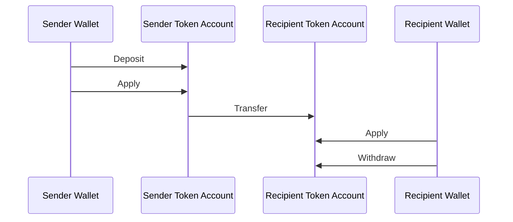
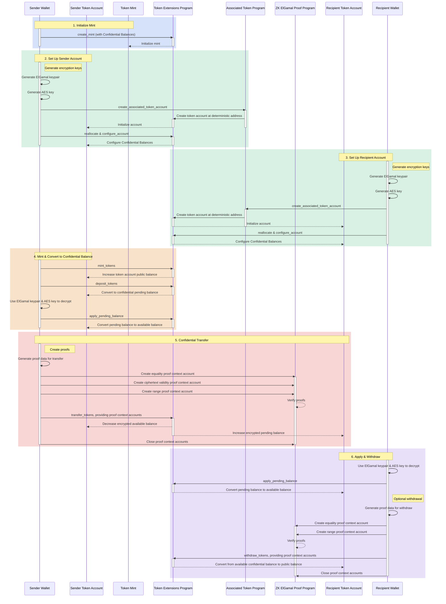

## Cosa sono i Saldi Riservati?

<Frame>
  <iframe src="https://www.youtube-nocookie.com/embed/Bqs95tFcRIU" title="YouTube video player" allow="accelerometer; autoplay; clipboard-write; encrypted-media; gyroscope; picture-in-picture; web-share" referrerPolicy="strict-origin-when-cross-origin" allowFullScreen className="w-full aspect-video" />
</Frame>

  [https://www.youtube.com/watch?v=Bqs95tFcRIU](https://www.youtube.com/watch?v=Bqs95tFcRIU)

Saldi Riservati è un'estensione Token-2022 che consente di trasferire token
tra token account senza rivelare l'importo del trasferimento. Ciò è utile per
transazioni che preservano la privacy. Solo gli importi dei trasferimenti e i saldi dei token sono
privati. Gli indirizzi dei token account rimangono pubblici.

- [Panoramica del protocollo](https://www.solana-program.com/docs/confidential-balances/overview) -
  Dettagli sul protocollo crittografico sottostante
- [Guida rapida](https://www.solana-program.com/docs/confidential-balances#setup) -
  Configurazione e comandi CLI di base
- [Cookbook sui Saldi Riservati](https://github.com/solana-developers/Confidential-Balances-Sample) -
  Frammenti di codice che mostrano come utilizzare i Saldi Riservati

### Come funziona?

L'estensione Saldi Riservati aggiunge
[istruzioni](https://github.com/solana-program/token-2022/blob/efd0c957fefbd79882d77df5fb2dac88c001249c/program/src/extension/confidential_transfer/instruction.rs#L29)
al programma Token Extension che consente di trasferire token tra
account senza rivelare l'importo del trasferimento.

  

  

Confidential Balances Basic Overview

Il flusso di base dei trasferimenti riservati di token è il seguente:

1. Crea un mint account con i Saldi Riservati abilitati.
2. Crea token account con i Saldi Riservati abilitati per il mittente e
   il destinatario.
3. Conia token sul account del mittente.
4. **Deposita** il saldo pubblico del mittente nel **saldo in attesa
   riservato**.
5. **Applica** il saldo in attesa del mittente al **saldo disponibile
   riservato**.
6. **Trasferisci** in modo riservato i token dal token account del mittente al
   token account del destinatario.
7. **Applica** il saldo in attesa del destinatario al **saldo disponibile
   riservato**.
8. **Preleva** il saldo disponibile riservato del destinatario nel **saldo
   pubblico**.

### Chiavi dell'auditor

Un mint di Saldi Riservati può memorizzare una chiave pubblica ElGamal opzionale per un auditor globale. Quando ne viene configurata una, ogni trasferimento riservato include l'importo crittografato per il mittente, il destinatario e l'auditor. La prova di trasferimento verifica che tutti e tre i testi cifrati contengano lo stesso importo. Il pubblico non può comunque leggere l'importo, ma il titolare della chiave segreta dell'auditor può decrittografare gli importi dei trasferimenti per quel mint.

L'autorità dei Saldi Riservati imposta la chiave dell'auditor durante l'inizializzazione dell'estensione o la modifica in seguito con `UpdateMint`. L'autorità può ruotare o cancellare la chiave. Una rotazione si applica solo ai trasferimenti futuri, quindi è necessario conservare le chiavi segrete precedenti quando si richiede l'accesso storico all'audit. Le chiavi dell'auditor forniscono accesso in lettura; non autorizzano trasferimenti di token né rivelano il saldo riservato completo di un account.

Per esempi di configurazione e rotazione, consulta
[Configurare un auditor](/docs/tokens/extensions/confidential-transfer/issuer-guide#configure-an-auditor).
I wallet, gli explorer, le exchange e i fornitori di servizi di conformità dovrebbero anche consultare la
[guida all'integrazione dell'auditor](/docs/tokens/extensions/confidential-transfer/integration-guide#auditors-and-compliance).

Per ulteriori dettagli sui passaggi del flusso di trasferimento riservato,
consulta le pagine corrispondenti:

<Columns cols={2}>
  <Card
    title="Crea Mint Account"
    href="/docs/tokens/extensions/confidential-transfer/create-mint"
  >
    Come creare un mint account con i Saldi Riservati abilitati
  </Card>
  <Card
    title="Crea Token Account"
    href="/docs/tokens/extensions/confidential-transfer/create-token-account"
  >
    Come configurare un token account con i Saldi Riservati abilitati
  </Card>
  <Card
    title="Deposita Token"
    href="/docs/tokens/extensions/confidential-transfer/deposit-tokens"
  >
    Come depositare token nel saldo in attesa riservato
  </Card>
  <Card
    title="Applica Saldo in Attesa"
    href="/docs/tokens/extensions/confidential-transfer/apply-pending-balance"
  >
    Come applicare il saldo in attesa al saldo disponibile riservato
  </Card>
  <Card
    title="Preleva Token"
    href="/docs/tokens/extensions/confidential-transfer/withdraw-tokens"
  >
    Come prelevare token dal saldo disponibile riservato
  </Card>
  <Card
    title="Trasferisci Token"
    href="/docs/tokens/extensions/confidential-transfer/transfer-tokens"
  >
    Come trasferire in modo riservato token tra token account
  </Card>
  <Card
    title="Guida all'integrazione"
    href="/docs/tokens/extensions/confidential-transfer/integration-guide"
  >
    Come wallet, explorer ed exchange possono supportare i token con Saldi Riservati
  </Card>
  <Card
    title="Guida per l'emittente"
    href="/docs/tokens/extensions/confidential-transfer/issuer-guide"
  >
    Come emettere e gestire un token con Saldi Riservati (policy di approvazione,
    auditor, commissioni, mint e burn)
  </Card>
</Columns>

Il diagramma seguente mostra una sequenza dettagliata del flusso di base per i
trasferimenti di token riservati:

  

  

Confidential Balances Detailed Overview

## Istruzioni per i Saldi Riservati

L'elenco completo delle
[istruzioni](https://github.com/solana-program/token-2022/blob/efd0c957fefbd79882d77df5fb2dac88c001249c/program/src/extension/confidential_transfer/instruction.rs#L29)
dell'estensione Saldi Riservati è il seguente:

| Instruction                     | Description                                                                                                                                                      |
| ------------------------------- | ---------------------------------------------------------------------------------------------------------------------------------------------------------------- |
| `InitializeMint`                | Abilita i Saldi Riservati su un mint account. Questa istruzione deve essere inclusa nella stessa transazione dell'istruzione `TokenInstruction::InitializeMint`. |
| `UpdateMint`                    | Aggiorna la policy di approvazione degli account del mint e la chiave pubblica ElGamal opzionale dell'auditor globale.                                           |
| `ConfigureAccount`              | Abilita i Saldi Riservati su un token account.                                                                                                                   |
| `ApproveAccount`                | Approva un token account per i Saldi Riservati se il mint richiede l'approvazione per i nuovi token account.                                                     |
| `EmptyAccount`                  | Svuota i saldi riservati in sospeso e disponibili per consentire la chiusura di un token account.                                                                |
| `Deposit`                       | Converte il saldo pubblico di token in saldo riservato in sospeso.                                                                                               |
| `Withdraw`                      | Converte il saldo riservato disponibile nuovamente in saldo pubblico.                                                                                            |
| `Transfer`                      | Trasferisce token tra token account in modo riservato.                                                                                                           |
| `ApplyPendingBalance`           | Converte il saldo in sospeso in saldo disponibile dopo depositi o trasferimenti.                                                                                 |
| `EnableConfidentialCredits`     | Consente a un token account di ricevere trasferimenti di token riservati.                                                                                        |
| `DisableConfidentialCredits`    | Blocca i trasferimenti riservati in entrata consentendo comunque i trasferimenti pubblici.                                                                       |
| `EnableNonConfidentialCredits`  | Consente a un token account di ricevere trasferimenti di token pubblici.                                                                                         |
| `DisableNonConfidentialCredits` | Blocca i trasferimenti regolari affinché l'account riceva solo trasferimenti riservati.                                                                          |
| `TransferWithFee`               | Trasferisce token tra token account in modo riservato con una commissione.                                                                                       |
| `ConfigureAccountWithRegistry`  | Metodo alternativo per configurare i token account per i Saldi Riservati utilizzando un account `ElGamalRegistry` invece della prova `VerifyPubkeyValidity`.     |
