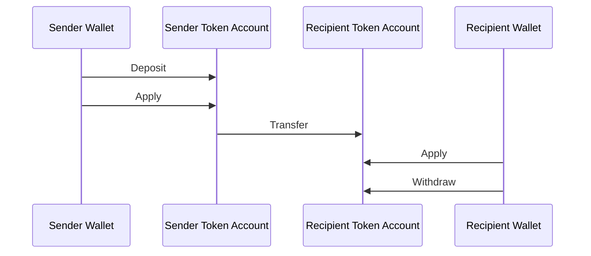
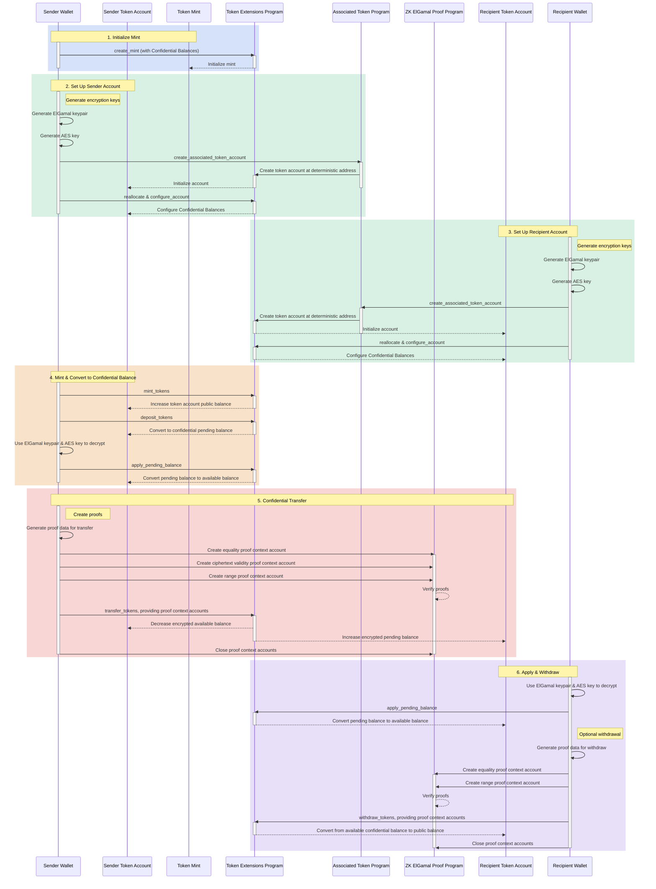

## 기밀 잔액이란 무엇인가요?

<Frame>
  <iframe src="https://www.youtube-nocookie.com/embed/Bqs95tFcRIU" title="YouTube video player" allow="accelerometer; autoplay; clipboard-write; encrypted-media; gyroscope; picture-in-picture; web-share" referrerPolicy="strict-origin-when-cross-origin" allowFullScreen className="w-full aspect-video" />
</Frame>

  [https://www.youtube.com/watch?v=Bqs95tFcRIU](https://www.youtube.com/watch?v=Bqs95tFcRIU)

기밀 잔액은 전송 금액을 공개하지 않고 token account 간에 토큰을 전송할 수 있는 Token-2022 익스텐션입니다. 이는 프라이버시를 보존하는 트랜잭션에 유용합니다. 전송 금액과 토큰 잔액만 비공개로 유지됩니다. Token account 주소는 공개 상태로 유지됩니다.

- [프로토콜 개요](https://www.solana-program.com/docs/confidential-balances/overview) -
  기반 암호화 프로토콜에 대한 세부 정보
- [빠른 시작 가이드](https://www.solana-program.com/docs/confidential-balances#setup) -
  설정 및 기본 CLI 명령어
- [기밀 잔액 쿡북](https://github.com/solana-developers/Confidential-Balances-Sample) -
  기밀 잔액 사용 방법을 보여주는 코드 스니펫

### 작동 방식

기밀 잔액 익스텐션은 Token Extension program에
[명령어](https://github.com/solana-program/token-2022/blob/efd0c957fefbd79882d77df5fb2dac88c001249c/program/src/extension/confidential_transfer/instruction.rs#L29)를
추가하여 전송 금액을 공개하지 않고 계정 간에 토큰을 전송할 수 있게 합니다.

  

  

Confidential Balances Basic Overview

기밀 토큰 전송의 기본 흐름은 다음과 같습니다:

1. 기밀 잔액이 활성화된 mint account를 생성합니다.
2. 송신자와 수신자를 위해 기밀 잔액이 활성화된 token account를 생성합니다.
3. 송신자 계정에 토큰을 발행합니다.
4. 송신자의 공개 잔액을 **기밀 대기 잔액**으로 **입금**합니다.
5. 송신자의 대기 잔액을 **기밀 사용 가능 잔액**으로 **적용**합니다.
6. 송신자 token account에서 수신자 token account로 기밀 **전송**을 수행합니다.
7. 수신자의 대기 잔액을 **기밀 사용 가능 잔액**으로 **적용**합니다.
8. 수신자의 기밀 사용 가능 잔액을 **공개 잔액**으로 **출금**합니다.

### 감사자 키

기밀 잔액 mint는 선택적 글로벌 감사자 ElGamal 공개 키를 저장할 수 있습니다. 감사자 키가 설정된 경우, 모든 기밀 전송에는 송신자, 수신자, 감사자를 위해 암호화된 금액이 포함됩니다. 전송 증명은 세 개의 암호문이 동일한 금액을 포함하고 있음을 검증합니다. 일반 대중은 여전히 금액을 읽을 수 없지만, 감사자 비밀 키의 보유자는 해당 mint에 대한 전송 금액을 복호화할 수 있습니다.

기밀 잔액 권한은 익스텐션을 초기화할 때 감사자 키를 설정하거나 나중에 `UpdateMint`를 사용하여 변경할 수 있습니다. 권한은 키를 교체하거나 삭제할 수 있습니다. 키 교체는 이후의 전송에만 적용되므로, 과거 감사 접근이 필요한 경우 이전 비밀 키를 보관해야 합니다. 감사자 키는 읽기 접근 권한을 제공하며, 토큰 전송을 승인하거나 계정의 전체 기밀 잔액을 공개하지 않습니다.

설정 및 교체 예시는
[감사자 구성](/docs/tokens/extensions/confidential-transfer/issuer-guide#configure-an-auditor)을
참조하세요. 지갑, 익스플로러, 거래소 및 컴플라이언스 제공업체는
[감사자 통합 가이드](/docs/tokens/extensions/confidential-transfer/integration-guide#auditors-and-compliance)도
검토해야 합니다.

기밀 전송 흐름의 각 단계에 대한 자세한 내용은 해당 페이지를 참조하세요:

<Columns cols={2}>
  <Card
    title="Mint Account 생성"
    href="/docs/tokens/extensions/confidential-transfer/create-mint"
  >
    기밀 잔액이 활성화된 mint account 생성 방법
  </Card>
  <Card
    title="Token Account 생성"
    href="/docs/tokens/extensions/confidential-transfer/create-token-account"
  >
    기밀 잔액이 활성화된 token account 구성 방법
  </Card>
  <Card
    title="토큰 입금"
    href="/docs/tokens/extensions/confidential-transfer/deposit-tokens"
  >
    기밀 대기 잔액에 토큰을 입금하는 방법
  </Card>
  <Card
    title="대기 잔액 적용"
    href="/docs/tokens/extensions/confidential-transfer/apply-pending-balance"
  >
    대기 잔액을 사용 가능한 기밀 잔액에 적용하는 방법
  </Card>
  <Card
    title="토큰 출금"
    href="/docs/tokens/extensions/confidential-transfer/withdraw-tokens"
  >
    기밀 사용 가능 잔액에서 토큰을 출금하는 방법
  </Card>
  <Card
    title="토큰 전송"
    href="/docs/tokens/extensions/confidential-transfer/transfer-tokens"
  >
    token account 간에 기밀로 토큰을 전송하는 방법
  </Card>
  <Card
    title="통합 가이드"
    href="/docs/tokens/extensions/confidential-transfer/integration-guide"
  >
    지갑, 익스플로러, 거래소가 기밀 잔액 토큰을 지원하는 방법
  </Card>
  <Card
    title="발행자 가이드"
    href="/docs/tokens/extensions/confidential-transfer/issuer-guide"
  >
    기밀 잔액 토큰 발행 및 운영 방법 (승인 정책, 감사자, 수수료, 발행 및 소각)
  </Card>
</Columns>

아래 다이어그램은 기밀 토큰 전송의 기본 흐름에 대한 상세한 순서를 보여줍니다:

  

  

Confidential Balances Detailed Overview

## 기밀 잔액 명령어

기밀 잔액 익스텐션
[명령어](https://github.com/solana-program/token-2022/blob/efd0c957fefbd79882d77df5fb2dac88c001249c/program/src/extension/confidential_transfer/instruction.rs#L29)의
전체 목록은 다음과 같습니다:

| 명령어                             | 설명                                                                                                |
| ------------------------------- | ------------------------------------------------------------------------------------------------- |
| `InitializeMint`                | mint account에서 기밀 잔액을 활성화합니다. 이 명령어는 `TokenInstruction::InitializeMint` 명령어와 동일한 트랜잭션에 포함되어야 합니다. |
| `UpdateMint`                    | mint의 계정 승인 정책 및 선택적 글로벌 감사자 ElGamal 공개 키를 업데이트합니다.                                               |
| `ConfigureAccount`              | token account에서 기밀 잔액을 활성화합니다.                                                                    |
| `ApproveAccount`                | mint가 새 token account에 대한 승인을 요구하는 경우 기밀 잔액에 대해 token account를 승인합니다.                             |
| `EmptyAccount`                  | token account를 닫을 수 있도록 대기 중 및 사용 가능한 기밀 잔액을 비웁니다.                                                |
| `Deposit`                       | 공개 토큰 잔액을 대기 중인 기밀 잔액으로 변환합니다.                                                                    |
| `Withdraw`                      | 사용 가능한 기밀 잔액을 공개 잔액으로 다시 변환합니다.                                                                   |
| `Transfer`                      | token account 간에 기밀로 토큰을 전송합니다.                                                                   |
| `ApplyPendingBalance`           | 입금 또는 전송 후 대기 중인 잔액을 사용 가능한 잔액으로 변환합니다.                                                           |
| `EnableConfidentialCredits`     | token account가 기밀 토큰 전송을 받을 수 있도록 허용합니다.                                                          |
| `DisableConfidentialCredits`    | 공개 전송은 허용하면서 수신되는 기밀 전송을 차단합니다.                                                                   |
| `EnableNonConfidentialCredits`  | token account가 공개 토큰 전송을 받을 수 있도록 허용합니다.                                                          |
| `DisableNonConfidentialCredits` | 일반 전송을 차단하여 계정이 기밀 전송만 받을 수 있도록 합니다.                                                              |
| `TransferWithFee`               | token account 간에 수수료와 함께 기밀로 토큰을 전송합니다.                                                           |
| `ConfigureAccountWithRegistry`  | `VerifyPubkeyValidity` 증명 대신 `ElGamalRegistry` 계정을 사용하여 기밀 잔액을 위한 token account를 구성하는 대안적인 방법입니다. |
