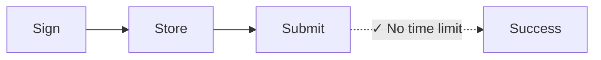
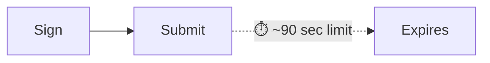

Każda transakcja w sieci Solana zawiera ostatni blockhash — odniesienie do
aktualnego stanu sieci, które potwierdza, że transakcja została utworzona
„teraz”. Sieć odrzuca każdą transakcję z blockhashem starszym niż około 150
bloków (czyli 60–90 sekund), zapobiegając atakom powtórzeniowym i
przeterminowanym zgłoszeniom. To rozwiązanie sprawdza się idealnie w przypadku
płatności w czasie rzeczywistym. Jednak nie działa w procesach, które wymagają
przerwy między podpisaniem a wysłaniem transakcji, takich jak:

| Scenariusz                   | Dlaczego standardowe transakcje zawodzą                                            |
| -------------------------- | ------------------------------------------------------------------------- |
| **Operacje skarbowe**    | CFO w Tokio podpisuje, kontroler w Nowym Jorku akceptuje — 90 sekund to za mało    |
| **Procesy zgodności**   | Transakcje wymagają przeglądu prawnego/zgodności przed wykonaniem                |
| **Podpisywanie offline**   | Maszyny odizolowane od sieci wymagają ręcznego przeniesienia podpisanych transakcji        |
| **Przygotowanie paczek**      | Przygotuj listę płac lub wypłaty w godzinach pracy, wykonaj je nocą |
| **Koordynacja multi-sig** | Wielu akceptantów w różnych strefach czasowych                                      |
| **Płatności zaplanowane**     | Zaplanuj płatności do realizacji w przyszłości                         |

W tradycyjnych finansach podpisany czek nie traci ważności po 90 sekundach.
Niektóre operacje blockchainowe również nie powinny. **Trwałe nonce** rozwiązują
ten problem, zastępując ostatni blockhash przechowywaną, trwałą wartością, która
zmienia się tylko podczas użycia — dzięki temu transakcje pozostają ważne,
dopóki nie zdecydujesz się ich wysłać.

## Jak to działa

Zamiast używać ostatniego blockhasha (ważnego przez około 150 bloków),
korzystasz z **konta nonce** – specjalnego konta, które przechowuje _unikalną_
wartość mogącą zastąpić blockhash. Każda transakcja używająca tego nonce musi
"zaktualizować" go jako pierwszą instrukcję. Każda wartość nonce może być użyta
tylko w jednej transakcji.



<div className="sol-mermaid" data-fallback="mermaid" data-mermaid="f4ea42c74587">
  

  

  

  
</div>

<p className="sol-caption">Durable Nonce</p>



<div className="sol-mermaid" data-fallback="mermaid" data-mermaid="1dab11cbf7b4">
  

  

  

  
</div>

<p className="sol-caption">Standard Blockhash</p>

<Info>
  Konto nonce kosztuje około 0,0015 SOL, aby było zwolnione z opłaty rent. Jedno
  konto nonce = jedna oczekująca transakcja naraz. Dla równoległych operacji
  utwórz wiele kont nonce.
</Info>

### Utwórz konto nonce

Utworzenie konta nonce wymaga dwóch instrukcji w jednej transakcji:

1. **Utwórz konto** używając `getCreateAccountInstruction` z System Program
2. **Zainicjuj je jako nonce** używając `getInitializeNonceAccountInstruction`

<Steps>
  <Step title="Wygeneruj keypair">
    Wygeneruj nowy keypair, który posłuży jako adres konta nonce, oraz oblicz
    wymaganą przestrzeń i rent.

    ```ts title="Create Nonce Account"
    const nonceKeypair = await generateKeyPairSigner();
    const nonceSpace = BigInt(getNonceSize());
    const nonceRent = await rpc
      .getMinimumBalanceForRentExemption(nonceSpace)
      .send();
    ```
  </Step>

  <Step title="Utwórz instrukcję utworzenia konta">
    Utwórz konto należące do System Program z odpowiednią liczbą lamportów, aby było
    zwolnione z opłaty rent.

    ```ts title="Create Nonce Account" focus={7-13}
    const nonceKeypair = await generateKeyPairSigner();
    const nonceSpace = BigInt(getNonceSize());
    const nonceRent = await rpc
      .getMinimumBalanceForRentExemption(nonceSpace)
      .send();

    const createNonceAccountIx = getCreateAccountInstruction({
      payer: sender,
      newAccount: nonceKeypair,
      lamports: nonceRent,
      space: nonceSpace,
      programAddress: SYSTEM_PROGRAM_ADDRESS
    });
    ```
  </Step>

  <Step title="Utwórz instrukcję inicjalizacji nonce">
    Zainicjuj konto jako konto nonce, ustawiając autorytet, który może je
    aktualizować.

    ```ts title="Create Nonce Account" focus={15-18}
    const nonceKeypair = await generateKeyPairSigner();
    const nonceSpace = BigInt(getNonceSize());
    const nonceRent = await rpc
      .getMinimumBalanceForRentExemption(nonceSpace)
      .send();

    const createNonceAccountIx = getCreateAccountInstruction({
      payer: sender,
      newAccount: nonceKeypair,
      lamports: nonceRent,
      space: nonceSpace,
      programAddress: SYSTEM_PROGRAM_ADDRESS
    });

    const initNonceIx = getInitializeNonceAccountInstruction({
      nonceAccount: nonceKeypair.address,
      nonceAuthority: sender.address
    });
    ```
  </Step>

  <Step title="Zbuduj transakcję">
    Zbuduj transakcję z obiema instrukcjami.

    ```ts title="Create Nonce Account" focus={20-26}
    const nonceKeypair = await generateKeyPairSigner();
    const nonceSpace = BigInt(getNonceSize());
    const nonceRent = await rpc
      .getMinimumBalanceForRentExemption(nonceSpace)
      .send();

    const createNonceAccountIx = getCreateAccountInstruction({
      payer: sender,
      newAccount: nonceKeypair,
      lamports: nonceRent,
      space: nonceSpace,
      programAddress: SYSTEM_PROGRAM_ADDRESS
    });

    const initNonceIx = getInitializeNonceAccountInstruction({
      nonceAccount: nonceKeypair.address,
      nonceAuthority: sender.address
    });

    const { value: blockhash } = await rpc.getLatestBlockhash().send();
    const createNonceTx = pipe(
      createTransactionMessage({ version: 0 }),
      (tx) => setTransactionMessageFeePayerSigner(sender, tx),
      (tx) => setTransactionMessageLifetimeUsingBlockhash(blockhash, tx),
      (tx) =>
        appendTransactionMessageInstructions(
          [createNonceAccountIx, initNonceIx],
          tx
        )
    );
    ```
  </Step>

  <Step title="Podpisz i wyślij">
    Podpisz i wyślij transakcję, aby utworzyć i zainicjować konto nonce.

    ```ts title="Utwórz konto nonce" focus={32-37}
    const nonceKeypair = await generateKeyPairSigner();
    const nonceSpace = BigInt(getNonceSize());
    const nonceRent = await rpc
      .getMinimumBalanceForRentExemption(nonceSpace)
      .send();

    const createNonceAccountIx = getCreateAccountInstruction({
      payer: sender,
      newAccount: nonceKeypair,
      lamports: nonceRent,
      space: nonceSpace,
      programAddress: SYSTEM_PROGRAM_ADDRESS
    });

    const initNonceIx = getInitializeNonceAccountInstruction({
      nonceAccount: nonceKeypair.address,
      nonceAuthority: sender.address
    });

    const { value: blockhash } = await rpc.getLatestBlockhash().send();
    const createNonceTx = pipe(
      createTransactionMessage({ version: 0 }),
      (tx) => setTransactionMessageFeePayerSigner(sender, tx),
      (tx) => setTransactionMessageLifetimeUsingBlockhash(blockhash, tx),
      (tx) =>
        appendTransactionMessageInstructions(
          [createNonceAccountIx, initNonceIx],
          tx
        )
    );

    const signedCreateNonceTx =
      await signTransactionMessageWithSigners(createNonceTx);

    await sendAndConfirmTransactionFactory({ rpc, rpcSubscriptions })(
      signedCreateNonceTx,
      { commitment: "confirmed" }
    );
    ```
  </Step>
</Steps>

### Zbuduj odroczoną transakcję

Zamiast ostatniego blockhasha użyj `blockhash` z konta nonce jako okresu
ważności transakcji.

<Steps>
  <Step title="Pobierz nonce">
    Pobierz dane z konta nonce. Użyj `blockhash` z konta nonce jako okresu ważności
    transakcji.

    ```sh title="Example Nonce Account Data" highlight={5}
    {
      version: 1,
      state: 1,
      authority: 'HgjaL8artMtmntaQDVM2UBk3gppsYYERS4PkUhiaLZD1',
      blockhash: '5U7seXqfgZx1uh5DFhdH1vyBhr7XGRrKxBAnJJTbbUa',
      lamportsPerSignature: 5000n
    }
    ```

    ```ts title="Zbuduj odroczoną transakcję" focus={1}
    const { data: nonceData } = await fetchNonce(rpc, nonceKeypair.address);
    ```
  </Step>

  <Step title="Utwórz instrukcję transferu">
    Utwórz instrukcję dla swojej płatności. Ten przykład pokazuje transfer tokena.

    ```ts title="Zbuduj odroczoną transakcję" focus={3-8}
    const { data: nonceData } = await fetchNonce(rpc, nonceKeypair.address);

    const transferInstruction = getTransferInstruction({
      source: senderAta,
      destination: recipientAta,
      authority: sender.address,
      amount: 250_000n
    });
    ```
  </Step>

  <Step title="Zbuduj transakcję z trwałym nonce">
    Użyj `setTransactionMessageLifetimeUsingDurableNonce`, który ustawia nonce jako
    blockhash i automatycznie dodaje instrukcję advance nonce na początku.

    ```ts title="Zbuduj odroczoną transakcję" highlight={14-21} focus={10-23}
    const { data: nonceData } = await fetchNonce(rpc, nonceKeypair.address);

    const transferInstruction = getTransferInstruction({
      source: senderAta,
      destination: recipientAta,
      authority: sender.address,
      amount: 250_000n
    });

    const transactionMessage = pipe(
      createTransactionMessage({ version: 0 }),
      (tx) => setTransactionMessageFeePayerSigner(sender, tx),
      (tx) =>
        setTransactionMessageLifetimeUsingDurableNonce(
          {
            nonce: nonceData.blockhash as Nonce,
            nonceAccountAddress: nonceKeypair.address,
            nonceAuthorityAddress: nonceData.authority
          },
          tx
        ),
      (tx) => appendTransactionMessageInstructions([transferInstruction], tx)
    );
    ```
  </Step>

  <Step title="Podpisz transakcję">
    Podpisz transakcję. Teraz używa trwałego nonce zamiast standardowego blockhasha.

    ```ts title="Zbuduj odroczoną transakcję" focus={25-26}
    const { data: nonceData } = await fetchNonce(rpc, nonceKeypair.address);

    const transferInstruction = getTransferInstruction({
      source: senderAta,
      destination: recipientAta,
      authority: sender.address,
      amount: 250_000n
    });

    const transactionMessage = pipe(
      createTransactionMessage({ version: 0 }),
      (tx) => setTransactionMessageFeePayerSigner(sender, tx),
      (tx) =>
        setTransactionMessageLifetimeUsingDurableNonce(
          {
            nonce: nonceData.blockhash as Nonce,
            nonceAccountAddress: nonceKeypair.address,
            nonceAuthorityAddress: nonceData.authority
          },
          tx
        ),
      (tx) => appendTransactionMessageInstructions([transferInstruction], tx)
    );

    const signedTransaction =
      await signTransactionMessageWithSigners(transactionMessage);
    ```
  </Step>
</Steps>

### Przechowywanie lub wysyłanie transakcji

Po podpisaniu zakoduj transakcję do przechowywania. Gdy będziesz gotowy, wyślij
ją do sieci.

<Steps>
  <Step title="Kodowanie do przechowywania">
    Zakoduj podpisaną transakcję do formatu base64. Przechowaj tę wartość w swojej
    bazie danych.

    ```ts title="Przechowaj i wykonaj" focus={4-5}
    const signedTransaction =
      await signTransactionMessageWithSigners(transactionMessage);

    const base64EncodedTransaction =
      getBase64EncodedWireTransaction(signedTransaction);

    // Store base64EncodedTransaction in your database
    ```
  </Step>

  <Step title="Wyślij transakcję">
    Wyślij podpisaną transakcję, gdy będziesz gotowy. Transakcja pozostaje ważna,
    dopóki nonce nie zostanie zaktualizowany.

    ```ts title="Przechowaj i wykonaj" focus={8-10}
    const signedTransaction =
      await signTransactionMessageWithSigners(transactionMessage);

    const base64EncodedTransaction =
      getBase64EncodedWireTransaction(signedTransaction);

    // When ready to execute (could be days later):
    await rpc
      .sendTransaction(base64EncodedTransaction, { encoding: "base64" })
      .send();
    ```
  </Step>
</Steps>

### Demo

```ts Demo highlight={54,57-60,63-69,72-75,106,139-146,156-157,161-166} expandable
// Click ">" icon on left to expand demo imports
import {
  airdropFactory,
  appendTransactionMessageInstructions,
  assertIsTransactionWithBlockhashLifetime,
  assertIsTransactionWithDurableNonceLifetime,
  createSolanaRpc,
  createSolanaRpcSubscriptions,
  createTransactionMessage,
  generateKeyPairSigner,
  getSignatureFromTransaction,
  lamports,
  type Nonce,
  pipe,
  sendAndConfirmTransactionFactory,
  setTransactionMessageFeePayerSigner,
  setTransactionMessageLifetimeUsingBlockhash,
  setTransactionMessageLifetimeUsingDurableNonce,
  signTransactionMessageWithSigners,
  type KeyPairSigner,
  getBase64EncodedWireTransaction
} from "@solana/kit";
import {
  fetchNonce,
  getCreateAccountInstruction,
  getInitializeNonceAccountInstruction,
  getNonceSize,
  SYSTEM_PROGRAM_ADDRESS
} from "@solana-program/system";
import {
  getCreateAssociatedTokenInstructionAsync,
  getInitializeMintInstruction,
  getMintSize,
  TOKEN_2022_PROGRAM_ADDRESS,
  findAssociatedTokenPda,
  getMintToInstruction,
  getTransferInstruction
} from "@solana-program/token-2022";

// Generate keypairs for sender and recipient
const sender = await generateKeyPairSigner();
const recipient = await generateKeyPairSigner();

console.log("Sender Address:", sender.address);
console.log("Recipient Address:", recipient.address);

// Demo Setup: Create RPC connection, mint, and token accounts
const { rpc, rpcSubscriptions, mint } = await demoSetup(sender, recipient);

// =============================================================================
// Step 1: Create a Nonce Account
// =============================================================================

const nonceKeypair = await generateKeyPairSigner();
console.log("\nNonce Account Address:", nonceKeypair.address);

const nonceSpace = BigInt(getNonceSize());
const nonceRent = await rpc
  .getMinimumBalanceForRentExemption(nonceSpace)
  .send();

// Instruction to create new account for the nonce
const createNonceAccountIx = getCreateAccountInstruction({
  payer: sender,
  newAccount: nonceKeypair,
  lamports: nonceRent,
  space: nonceSpace,
  programAddress: SYSTEM_PROGRAM_ADDRESS
});

// Instruction to initialize the nonce account
const initNonceIx = getInitializeNonceAccountInstruction({
  nonceAccount: nonceKeypair.address,
  nonceAuthority: sender.address
});

// Build and send nonce account creation transaction
const { value: blockhash } = await rpc.getLatestBlockhash().send();
const createNonceTx = pipe(
  createTransactionMessage({ version: 0 }),
  (tx) => setTransactionMessageFeePayerSigner(sender, tx),
  (tx) => setTransactionMessageLifetimeUsingBlockhash(blockhash, tx),
  (tx) =>
    appendTransactionMessageInstructions(
      [createNonceAccountIx, initNonceIx],
      tx
    )
);

const signedCreateNonceTx =
  await signTransactionMessageWithSigners(createNonceTx);
assertIsTransactionWithBlockhashLifetime(signedCreateNonceTx);

await sendAndConfirmTransactionFactory({ rpc, rpcSubscriptions })(
  signedCreateNonceTx,
  { commitment: "confirmed" }
);

console.log("Nonce Account created.");

// =============================================================================
// Step 2: Token Payment with Durable Nonce
// =============================================================================

// Fetch current nonce value from the nonce account
const { data: nonceData } = await fetchNonce(rpc, nonceKeypair.address);
console.log("Nonce Account data:", nonceData);

const [senderAta] = await findAssociatedTokenPda({
  mint: mint.address,
  owner: sender.address,
  tokenProgram: TOKEN_2022_PROGRAM_ADDRESS
});

const [recipientAta] = await findAssociatedTokenPda({
  mint: mint.address,
  owner: recipient.address,
  tokenProgram: TOKEN_2022_PROGRAM_ADDRESS
});

console.log("\nMint Address:", mint.address);
console.log("Sender Token Account:", senderAta);
console.log("Recipient Token Account:", recipientAta);

const transferInstruction = getTransferInstruction({
  source: senderAta,
  destination: recipientAta,
  authority: sender.address,
  amount: 250_000n // 0.25 tokens
});

// Create transaction message using durable nonce lifetime
// setTransactionMessageLifetimeUsingDurableNonce automatically prepends
// the AdvanceNonceAccount instruction
const transactionMessage = pipe(
  createTransactionMessage({ version: 0 }),
  (tx) => setTransactionMessageFeePayerSigner(sender, tx),
  (tx) =>
    setTransactionMessageLifetimeUsingDurableNonce(
      {
        nonce: nonceData.blockhash as string as Nonce,
        nonceAccountAddress: nonceKeypair.address,
        nonceAuthorityAddress: nonceData.authority
      },
      tx
    ),
  (tx) => appendTransactionMessageInstructions([transferInstruction], tx)
);

const signedTransaction =
  await signTransactionMessageWithSigners(transactionMessage);
assertIsTransactionWithDurableNonceLifetime(signedTransaction);
const transactionSignature = getSignatureFromTransaction(signedTransaction);

// Encode the transaction to base64, optionally save and send at a later time
const base64EncodedTransaction =
  getBase64EncodedWireTransaction(signedTransaction);
console.log("\nBase64 Encoded Transaction:", base64EncodedTransaction);

// Send the encoded transaction, blockhash does not expire
await rpc
  .sendTransaction(base64EncodedTransaction, {
    encoding: "base64",
    skipPreflight: true
  })
  .send();

console.log("\n=== Token Payment with Durable Nonce Complete ===");
console.log("Transaction Signature:", transactionSignature);

// =============================================================================
// Demo Setup Helper Function
// =============================================================================

/**
 * Sets up for a token transfer demo:
 * - Creates RPC connection
 * - Airdrops SOL to sender for transaction fees
 * - Generates mint keypair and creates/initializes mint account
 * - Creates associated token accounts for sender and recipient
 * - Mints initial tokens to sender
 *
 * @param sender - The sender's keypair (will be funded and used as mint authority)
 * @param recipient - The recipient's keypair
 * @returns RPC connection and mint address
 */
async function demoSetup(sender: KeyPairSigner, recipient: KeyPairSigner) {
  const rpc = createSolanaRpc("http://localhost:8899");
  const rpcSubscriptions = createSolanaRpcSubscriptions("ws://localhost:8900");

  // Fund sender with SOL for transaction fees
  await airdropFactory({ rpc, rpcSubscriptions })({
    recipientAddress: sender.address,
    lamports: lamports(1_000_000_000n),
    commitment: "confirmed"
  });

  // Create Mint and Token Accounts
  const mint = await generateKeyPairSigner();

  const mintSpace = BigInt(getMintSize());
  const mintRent = await rpc
    .getMinimumBalanceForRentExemption(mintSpace)
    .send();

  const createMintAccountIx = getCreateAccountInstruction({
    payer: sender,
    newAccount: mint,
    lamports: mintRent,
    space: mintSpace,
    programAddress: TOKEN_2022_PROGRAM_ADDRESS
  });

  const initializeMintIx = getInitializeMintInstruction({
    mint: mint.address,
    decimals: 6,
    mintAuthority: sender.address
  });

  const [senderAta] = await findAssociatedTokenPda({
    mint: mint.address,
    owner: sender.address,
    tokenProgram: TOKEN_2022_PROGRAM_ADDRESS
  });

  const createSenderAtaIx = await getCreateAssociatedTokenInstructionAsync({
    payer: sender,
    mint: mint.address,
    owner: sender.address
  });

  const createRecipientAtaIx = await getCreateAssociatedTokenInstructionAsync({
    payer: sender,
    mint: mint.address,
    owner: recipient.address
  });

  const mintToIx = getMintToInstruction({
    mint: mint.address,
    token: senderAta,
    mintAuthority: sender.address,
    amount: 1_000_000n // Mint 1.00 tokens (1,000,000 base units with 6 decimals)
  });

  const { value: latestBlockhash } = await rpc.getLatestBlockhash().send();

  const instructions = [
    createMintAccountIx,
    initializeMintIx,
    createSenderAtaIx,
    createRecipientAtaIx,
    mintToIx
  ];

  const transactionMessage = pipe(
    createTransactionMessage({ version: 0 }),
    (tx) => setTransactionMessageFeePayerSigner(sender, tx),
    (tx) => setTransactionMessageLifetimeUsingBlockhash(latestBlockhash, tx),
    (tx) => appendTransactionMessageInstructions(instructions, tx)
  );

  const signedTransaction =
    await signTransactionMessageWithSigners(transactionMessage);

  assertIsTransactionWithBlockhashLifetime(signedTransaction);

  await sendAndConfirmTransactionFactory({ rpc, rpcSubscriptions })(
    signedTransaction,
    { commitment: "confirmed" }
  );

  return { rpc, rpcSubscriptions, mint };
}
```

## Unieważnienie oczekującej transakcji

Każde konto nonce `blockhash` można użyć tylko raz. Aby unieważnić oczekującą
transakcję lub przygotować konto nonce do ponownego użycia, zaktualizuj je
ręcznie:

```ts
import { getAdvanceNonceAccountInstruction } from "@solana-program/system";

// Submit this instruction (with a regular blockhash) to invalidate any pending transaction
getAdvanceNonceAccountInstruction({
  nonceAccount: nonceAddress,
  nonceAuthority
});
```

To wygeneruje nową wartość nonce, przez co każda transakcja podpisana starą
wartością stanie się trwale nieważna.

## Przepływ akceptacji wielostronnej

Deserializuj transakcję, aby dodać kolejne podpisy, a następnie ponownie ją
serializuj do przechowywania lub wysyłki:

```ts
import {
  getBase64Encoder,
  getTransactionDecoder,
  getBase64EncodedWireTransaction,
  partiallySignTransaction
} from "@solana/kit";

// Deserialize the stored transaction
const txBytes = getBase64Encoder().encode(serializedString);
const partiallySignedTx = getTransactionDecoder().decode(txBytes);

// Each approver adds their signature. partiallySignTransaction takes
// CryptoKeyPairs, so pass the KeyPairSigner's `keyPair`
const fullySignedTx = await partiallySignTransaction(
  [newKeyPairSigner.keyPair],
  partiallySignedTx
);

// Serialize again for storage or submission
const serialized = getBase64EncodedWireTransaction(fullySignedTx);
```

Transakcję można serializować, przechowywać i przekazywać pomiędzy akceptantami.
Gdy wszystkie wymagane podpisy zostaną zebrane, wyślij ją do sieci.

## Wskazówki produkcyjne

**Zarządzanie kontami nonce:**

- Utwórz pulę kont nonce do równoległego przygotowywania transakcji
- Śledź, które nonce są "w użyciu" (mają oczekujące podpisane transakcje)
- Wdróż recykling nonce po przesłaniu lub porzuceniu transakcji

**Bezpieczeństwo:**

- Uprawniony do nonce decyduje, czy transakcje mogą zostać unieważnione. Rozważ
  oddzielenie uprawnień do nonce od sygnatariuszy transakcji dla większej
  kontroli i rozdziału obowiązków
- _Każdy_, kto posiada zserializowane bajty transakcji, może przesłać ją do
  sieci

## Powiązane zasoby

- [Wprowadzenie do trwałych nonce](/developers/cookbook/transactions/durable-nonces)
