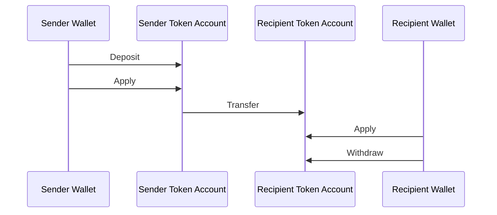
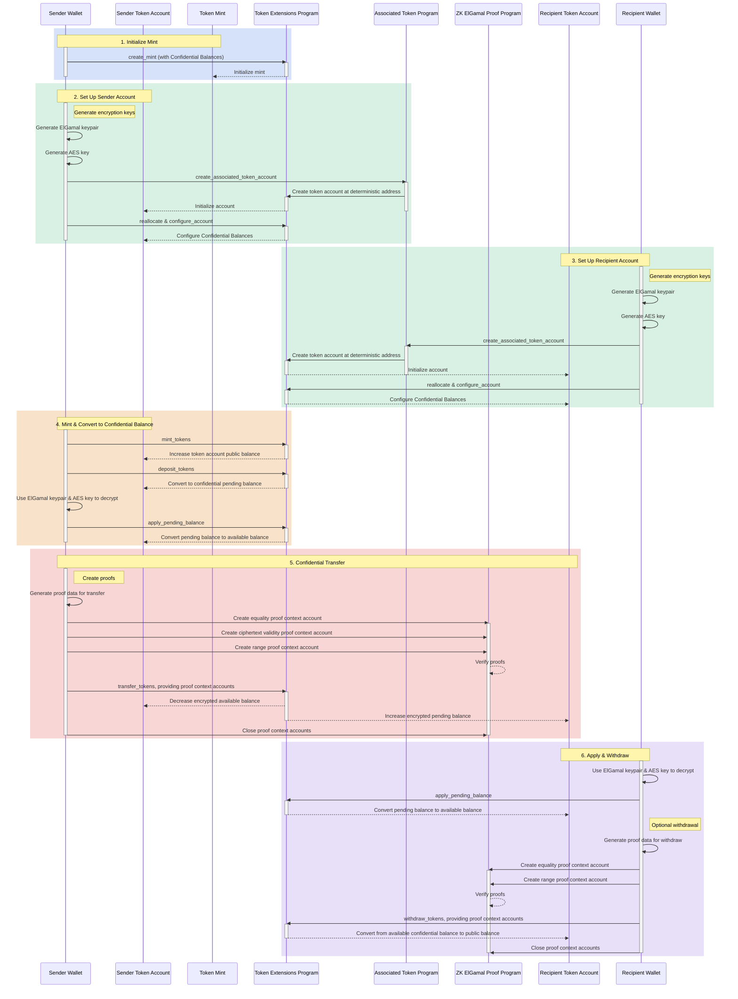

## Czym są Poufne Salda?

<Frame>
  <iframe src="https://www.youtube-nocookie.com/embed/Bqs95tFcRIU" title="YouTube video player" allow="accelerometer; autoplay; clipboard-write; encrypted-media; gyroscope; picture-in-picture; web-share" referrerPolicy="strict-origin-when-cross-origin" allowFullScreen className="w-full aspect-video" />
</Frame>

  [https://www.youtube.com/watch?v=Bqs95tFcRIU](https://www.youtube.com/watch?v=Bqs95tFcRIU)

Poufne Salda to rozszerzenie Token-2022, które umożliwia przesyłanie tokenów
między token accounts bez ujawniania kwoty transferu. Jest to przydatne w przypadku
transakcji zachowujących prywatność. Prywatne są tylko kwoty transferów i salda tokenów.
Adresy token accounts pozostają publiczne.

- [Przegląd protokołu](https://www.solana-program.com/docs/confidential-balances/overview) -
  Szczegóły dotyczące bazowego protokołu kryptograficznego
- [Przewodnik szybkiego startu](https://www.solana-program.com/docs/confidential-balances#setup) -
  Konfiguracja i podstawowe polecenia CLI
- [Confidential Balances Cookbook](https://github.com/solana-developers/Confidential-Balances-Sample) -
  Fragmenty kodu pokazujące, jak używać Poufnych Sald

### Jak to działa?

Rozszerzenie Poufnych Sald dodaje
[instrukcje](https://github.com/solana-program/token-2022/blob/efd0c957fefbd79882d77df5fb2dac88c001249c/program/src/extension/confidential_transfer/instruction.rs#L29)
do programu Token Extension, które umożliwiają przesyłanie tokenów między
kontami bez ujawniania kwoty transferu.

  

  

Confidential Balances Basic Overview

Podstawowy przebieg poufnych transferów tokenów jest następujący:

1. Utwórz mint account z włączonymi Poufnymi Saldami.
2. Utwórz token accounts z włączonymi Poufnymi Saldami dla nadawcy
   i odbiorcy.
3. Wyemituj tokeny na konto nadawcy.
4. **Wpłać** publiczne saldo nadawcy na **poufne saldo oczekujące**.
5. **Zastosuj** saldo oczekujące nadawcy jako **poufne saldo dostępne**.
6. Poufnie **prześlij** tokeny z token account nadawcy do token account
   odbiorcy.
7. **Zastosuj** saldo oczekujące odbiorcy jako **poufne saldo dostępne**.
8. **Wypłać** poufne saldo dostępne odbiorcy na **saldo publiczne**.

### Klucze audytora

Mint account z Poufnymi Saldami może przechowywać opcjonalny globalny klucz publiczny ElGamal audytora. Gdy jest skonfigurowany, każdy poufny transfer zawiera kwotę zaszyfrowaną dla nadawcy, odbiorcy i audytora. Dowód transferu weryfikuje, że wszystkie trzy szyfrogramy zawierają tę samą kwotę. Publiczność nadal nie może odczytać kwoty, ale posiadacz tajnego klucza audytora może odszyfrować kwoty transferów dla danego minta.

Uprawnienia Poufnych Sald ustawiają klucz audytora podczas inicjalizacji rozszerzenia lub zmieniają go później za pomocą `UpdateMint`. Uprawnienia mogą rotować lub usuwać klucz. Rotacja dotyczy tylko przyszłych transferów, dlatego należy zachować poprzednie tajne klucze, gdy wymagany jest historyczny dostęp do audytu. Klucze audytora zapewniają dostęp do odczytu; nie autoryzują transferów tokenów ani nie ujawniają pełnego poufnego salda konta.

Przykłady konfiguracji i rotacji można znaleźć w sekcji
[Konfiguracja audytora](/developers/docs/tokens/extensions/confidential-transfer/issuer-guide#configure-an-auditor).
Portfele, eksploratory, giełdy i dostawcy usług compliance powinni również zapoznać się z
[wytycznymi dotyczącymi integracji audytora](/developers/docs/tokens/extensions/confidential-transfer/integration-guide#auditors-and-compliance).

Aby uzyskać więcej informacji na temat kroków w procesie poufnego transferu,
zapoznaj się z odpowiednimi stronami:

<Columns cols={2}>
  <Card
    title="Utwórz Mint Account"
    href="/developers/docs/tokens/extensions/confidential-transfer/create-mint"
  >
    Jak utworzyć mint account z włączonymi Poufnymi Saldami
  </Card>
  <Card
    title="Utwórz Token Account"
    href="/developers/docs/tokens/extensions/confidential-transfer/create-token-account"
  >
    Jak skonfigurować token account z włączonymi Poufnymi Saldami
  </Card>
  <Card
    title="Wpłać tokeny"
    href="/developers/docs/tokens/extensions/confidential-transfer/deposit-tokens"
  >
    Jak wpłacić tokeny na poufne saldo oczekujące
  </Card>
  <Card
    title="Zastosuj saldo oczekujące"
    href="/developers/docs/tokens/extensions/confidential-transfer/apply-pending-balance"
  >
    Jak zastosować saldo oczekujące jako dostępne saldo poufne
  </Card>
  <Card
    title="Wypłać tokeny"
    href="/developers/docs/tokens/extensions/confidential-transfer/withdraw-tokens"
  >
    Jak wypłacić tokeny z poufnego salda dostępnego
  </Card>
  <Card
    title="Prześlij tokeny"
    href="/developers/docs/tokens/extensions/confidential-transfer/transfer-tokens"
  >
    Jak poufnie przesyłać tokeny między token accounts
  </Card>
  <Card
    title="Przewodnik integracji"
    href="/developers/docs/tokens/extensions/confidential-transfer/integration-guide"
  >
    Jak portfele, eksploratory i giełdy mogą obsługiwać tokeny Poufnych Sald
  </Card>
  <Card
    title="Przewodnik dla emitentów"
    href="/developers/docs/tokens/extensions/confidential-transfer/issuer-guide"
  >
    Jak emitować i zarządzać tokenem Poufnych Sald (polityka zatwierdzania, audytorzy, opłaty, mintowanie i spalanie)
  </Card>
</Columns>

Poniższy diagram przedstawia szczegółową sekwencję podstawowego przepływu dla
poufnych przelewów tokenów:

  

  

Confidential Balances Detailed Overview

## Instrukcje Poufnych Sald

Pełna lista
[instrukcji](https://github.com/solana-program/token-2022/blob/efd0c957fefbd79882d77df5fb2dac88c001249c/program/src/extension/confidential_transfer/instruction.rs#L29)
rozszerzenia Poufnych Sald jest następująca:

| Instrukcja                      | Opis                                                                                                                                           |
| ------------------------------- | ---------------------------------------------------------------------------------------------------------------------------------------------- |
| `InitializeMint`                | Włącza Poufne Salda na mint account. Ta instrukcja musi być zawarta w tej samej transakcji co instrukcja `TokenInstruction::InitializeMint`.   |
| `UpdateMint`                    | Aktualizuje politykę zatwierdzania kont minta oraz opcjonalny globalny klucz publiczny ElGamal audytora.                                       |
| `ConfigureAccount`              | Włącza Poufne Salda na token account.                                                                                                          |
| `ApproveAccount`                | Zatwierdza token account dla Poufnych Sald, jeśli mint wymaga zatwierdzenia dla nowych token accounts.                                         |
| `EmptyAccount`                  | Opróżnia oczekujące i dostępne poufne salda, aby umożliwić zamknięcie token account.                                                           |
| `Deposit`                       | Konwertuje publiczne saldo tokenów na oczekujące poufne saldo.                                                                                 |
| `Withdraw`                      | Konwertuje dostępne poufne saldo z powrotem na saldo publiczne.                                                                                |
| `Transfer`                      | Poufnie przesyła tokeny między token accounts.                                                                                                 |
| `ApplyPendingBalance`           | Konwertuje oczekujące saldo na dostępne saldo po wpłatach lub przelewach.                                                                      |
| `EnableConfidentialCredits`     | Umożliwia token account odbieranie poufnych przelewów tokenów.                                                                                 |
| `DisableConfidentialCredits`    | Blokuje przychodzące poufne przelewy, jednocześnie zezwalając na publiczne przelewy.                                                           |
| `EnableNonConfidentialCredits`  | Umożliwia token account odbieranie publicznych przelewów tokenów.                                                                              |
| `DisableNonConfidentialCredits` | Blokuje zwykłe przelewy, aby token account odbierał wyłącznie poufne przelewy.                                                                 |
| `TransferWithFee`               | Poufnie przesyła tokeny między token accounts z opłatą.                                                                                        |
| `ConfigureAccountWithRegistry`  | Alternatywny sposób konfigurowania token accounts dla Poufnych Sald przy użyciu konta `ElGamalRegistry` zamiast dowodu `VerifyPubkeyValidity`. |
