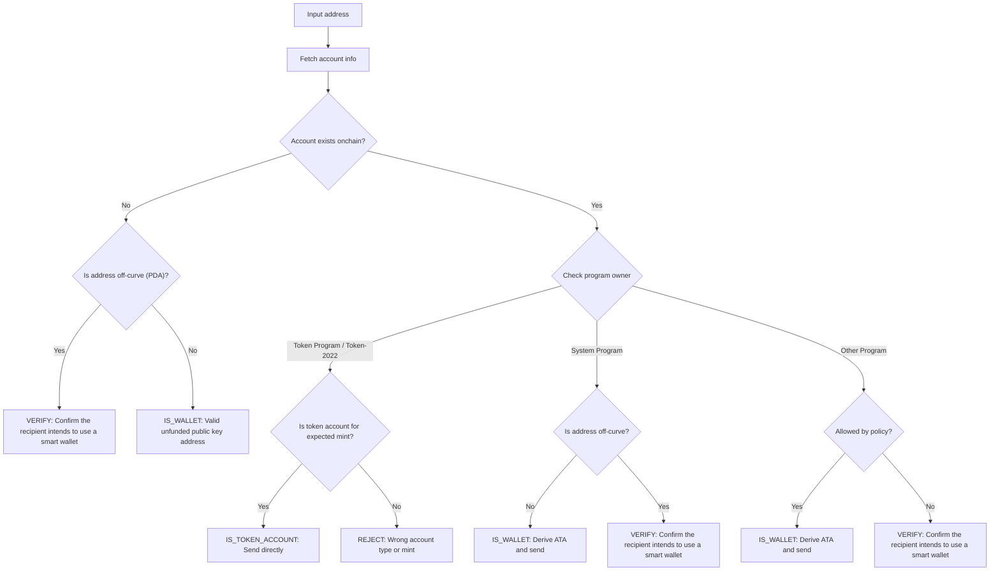
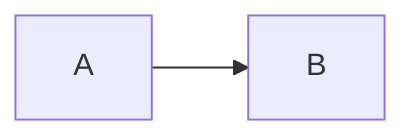

```ts !! title="Plugin"
import { createClient, generateKeyPairSigner, lamports } from "@solana/kit";
import { solanaRpc, rpcAirdrop } from "@solana/kit-plugin-rpc";
import { generatedPayer, airdropPayer } from "@solana/kit-plugin-signer";
import {
  findAssociatedTokenPda,
  tokenProgram,
  TOKEN_PROGRAM_ADDRESS
} from "@solana-program/token";

const client = await createClient()
  .use(generatedPayer())
  .use(
    solanaRpc({
      rpcUrl: "http://localhost:8899",
      rpcSubscriptionsUrl: "ws://localhost:8900"
    })
  )
  .use(rpcAirdrop())
  .use(airdropPayer(lamports(1_000_000_000n)))
  // !mark[/\.use\(tokenProgram\(\)\)/]
  .use(tokenProgram());

const mint = await generateKeyPairSigner();
const recipient = await generateKeyPairSigner();

// !collapse(1:16) collapsed
// Setup: create a mint and fund the payer's ATA before transferring tokens.
await client.sendTransaction([
  client.token.instructions.createMint({
    newMint: mint,
    decimals: 2,
    mintAuthority: client.payer.address,
    freezeAuthority: client.payer.address
  }),
  await client.token.instructions.mintToATA({
    mint: mint.address,
    owner: client.payer.address,
    mintAuthority: client.payer,
    amount: 100n,
    decimals: 2
  })
]);

const result = await client.token.instructions
  // !mark(1:7)
  .transferToATA({
    mint: mint.address, // Mint for the token being transferred.
    authority: client.payer, // Owner or delegate approving the transfer.
    recipient: recipient.address, // Account that owns the destination token account.
    amount: 25n, // Token amount in base units.
    decimals: 2 // Decimals defined on the mint account.
  })
  .sendTransaction();

const [sourceTokenAccount] = await findAssociatedTokenPda({
  mint: mint.address,
  owner: client.payer.address,
  tokenProgram: TOKEN_PROGRAM_ADDRESS
});

const [destinationTokenAccount] = await findAssociatedTokenPda({
  mint: mint.address,
  owner: recipient.address,
  tokenProgram: TOKEN_PROGRAM_ADDRESS
});

const [sourceTokenAccountData, destinationTokenAccountData] =
  await client.token.accounts.token.fetchAll([
    sourceTokenAccount,
    destinationTokenAccount
  ]);

console.log("Mint Address:", mint.address);
console.log("\nSource Token Account Address:", sourceTokenAccount);
console.log("Source Token Account:", sourceTokenAccountData.data);
console.log("\nDestination Token Account Address:", destinationTokenAccount);
console.log("Destination Token Account:", destinationTokenAccountData.data);
console.log("\nTransaction Signature:", result.context.signature);
```

```rs title="lib.rs"
pub fn process_instruction(
    _program_id: &Pubkey,
    _accounts: &[AccountInfo],
    _instruction_data: &[u8],
) -> ProgramResult {
    // !diff -
    msg!("Hello, world!");
    // !diff +
    msg!("Hello, Solana!");
    Ok(())
}
```

```rust title="Example"
use std::collections::HashMap;
use solana_sdk::{account::Account, pubkey::Pubkey};
use solana_system_interface::program::ID as SYSTEM_PROGRAM_ID;
use mollusk_svm::Mollusk;

let mollusk = Mollusk::default();
let account_address = Pubkey::new_unique();

// !focus(1:11)
let mut account_store = HashMap::new();
account_store.insert(
    account_address,
    Account {
        lamports: 1_000_000,
        data: vec![],
        owner: SYSTEM_PROGRAM_ID,
        executable: false,
        rent_epoch: 0,
    },
);

// !focus
// !mark
let context = mollusk.with_context(account_store);
```

```rust title="lib.rs" {13-16} /GameDataAccount/ /player_position/
use anchor_lang::prelude::*;

declare_id!("11111111111111111111111111111111");

#[program]
mod tiny_adventure {
    use super::*;

    ...
}

// Define the Game Data Account structure
#[account]
pub struct GameDataAccount {
    player_position: u8,
}

...
```

```rust title="programs/my-program/src/lib.rs" -w
// !tooltip[/pub mod constants/] constantsMod
pub mod constants;
// !tooltip[/pub mod error/] errorMod
pub mod error;
// !tooltip[/pub mod instructions/] instructionsMod
pub mod instructions;
// !tooltip[/pub mod state/] stateMod
pub mod state;

// !tooltip[/anchor_lang::prelude/] prelude
use anchor_lang::prelude::*;

pub use constants::*;
pub use instructions::*;
pub use state::*;

// !tooltip[/declare_id!/] declareId
declare_id!("82sFkffP9wxwpyfZyeaKHH2chQoJPUGsJZSPi9mrUuXd");

// !tooltip[/#\[program\]/] programMacro
#[program]
pub mod my_program {
    use super::*;

    // !tooltip[/pub fn initialize/] publicInstructions
    pub fn initialize(ctx: Context<Initialize>) -> Result<()> {
        // !tooltip[/handle_initialize/] handlers
        crate::instructions::initialize::handle_initialize(ctx)
    }

    // !tooltip[/pub fn increment/] publicInstructions
    pub fn increment(ctx: Context<Increment>) -> Result<()> {
        // !tooltip[/handle_increment/] handlers
        crate::instructions::increment::handle_increment(ctx)
    }
}
```

```rust name="Program"
use solana_program::entrypoint;
```

```json filename=package.json
{ "name": "example" }
```

``` title="output.txt"
plain text with a title but no language
```

```ts title="send-sol.ts" highlight=2-3
import { createClient } from "@solana/kit";
const client = createClient();
await client.send();
```

```sql
-- !mark
SELECT 1;
```

{/* Already in the docs format: unchanged */}

```ts Kit highlight={1} wrap
const x = 1;
```

```terminal
$ wsl --install
```

```terminal
$ sudo apt-get install -y \
    build-essential \
    pkg-config \
    libudev-dev llvm libclang-dev \
    protobuf-compiler libssl-dev
```

```terminal
$ sudo dnf group install c-development development-tools \
&& sudo dnf install pkg-config openssl-devel
```

```terminal
$ solana --version
solana-cli 2.2.0
$ anchor --version
anchor-cli 0.31.1
```

<CodeTabs>

```terminal !! title="CLI"
$ solana balance
$ solana airdrop 1
```

</CodeTabs>




