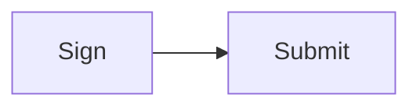

Output of fences.ts (title already moved to a caption):



<div className="nojs-only" data-fallback="mermaid">
  ```text Mermaid
  flowchart LR
      S1[Sign] --> S2[Submit]
  ```
</div>

<p className="sol-caption">Standard Blockhash</p>
