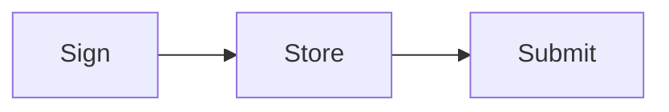
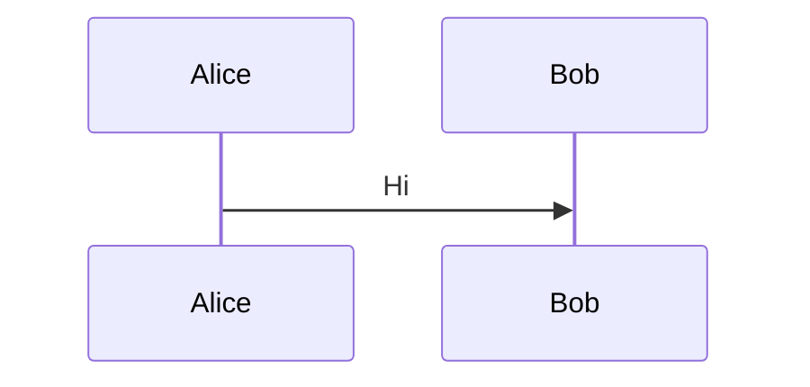
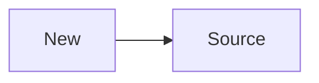

<Tabs>
  <Tab title="Diagram">
    ```mermaid
    flowchart TD
      A --> B
    ```
  </Tab>
</Tabs>

A diagram whose fallback is stale is re-synced:



<div className="nojs-only" data-fallback="mermaid">
  ```text Mermaid
  flowchart LR
      Old --> Source
  ```
</div>
