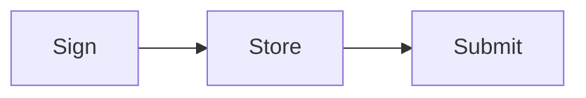
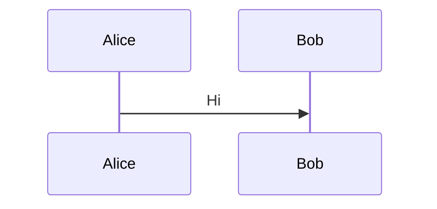

<div className="nojs-only" data-fallback="mermaid">
  ```text Mermaid
  flowchart LR
      D1[Sign] --> D2[Store] --> D3[Submit]
  ```
</div>

<p className="sol-caption">Durable Nonce</p>



<div className="nojs-only" data-fallback="mermaid">
  ```text Mermaid
  sequenceDiagram
      Alice->>Bob: Hi
  ```
</div>

<Tabs>
  <Tab title="Diagram">
    ```mermaid
    flowchart TD
      A --> B
    ```

    <div className="nojs-only" data-fallback="mermaid">
      ```text Mermaid
      flowchart TD
        A --> B
      ```
    </div>
  </Tab>
</Tabs>

A diagram whose fallback is stale is re-synced:


<div className="nojs-only" data-fallback="mermaid">
  ```text Mermaid
  flowchart LR
      New --> Source
  ```
</div>
