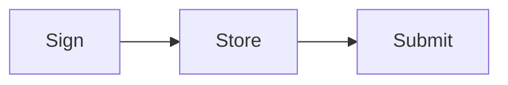
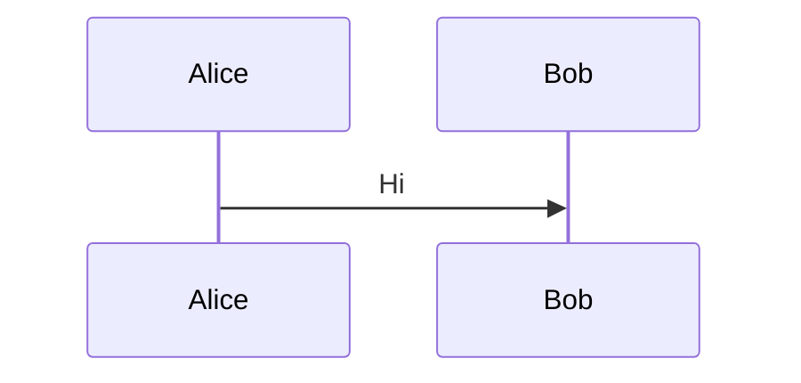
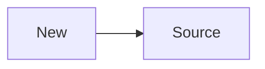

<div className="sol-mermaid" data-fallback="mermaid" data-mermaid="a18dccc8db34">
  

  

  

  
</div>

<p className="sol-caption">Durable Nonce</p>



<div className="sol-mermaid" data-fallback="mermaid" data-mermaid="34b4ca8298ba">
  

  

  

  
</div>

<Tabs>
  <Tab title="Diagram">
    ```mermaid
    flowchart TD
      A --> B
    ```

    <div className="sol-mermaid" data-fallback="mermaid" data-mermaid="1222fd6d8647">
      

      

      

      
    </div>
  </Tab>
</Tabs>

A diagram whose fallback is stale is re-synced:



<div className="sol-mermaid" data-fallback="mermaid" data-mermaid="2798a1e246e9">
  

  

  

  
</div>
