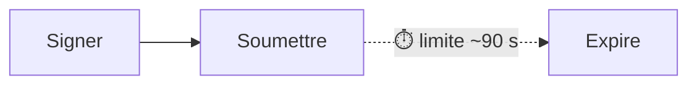

<div className="nojs-only" data-fallback="mermaid">
  ```text Mermaid
  flowchart LR
      S1[Signer] --> S2[Soumettre]
      S2 -. "⏱️ limite ~90 s" .-> S3[Expire]
  ```
</div>

<p className="sol-caption">Blockhash standard</p>

Texte après.
